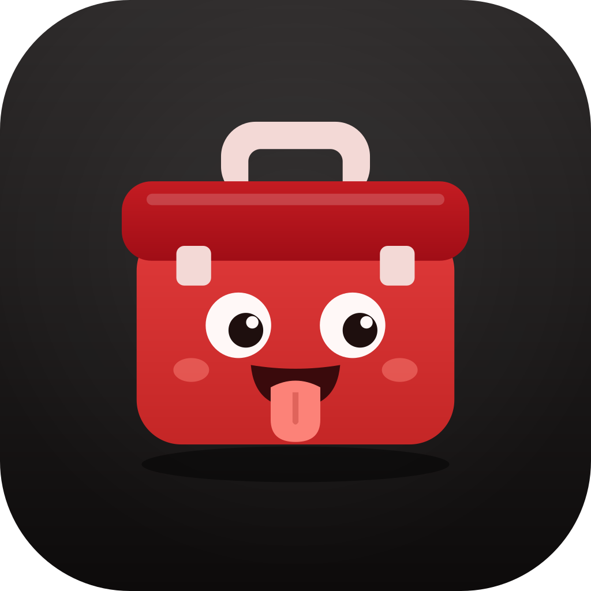

<p align="center"></p>

# ujibox

ujibox (`uji`) is a CLI that helps you build and debug Android and iOS
apps. It builds your app, keeps each build, and puts it on emulators,
simulators and devices in one step.

```console
$ uji install
• Shop · project shop · feature/login@3f9a01c2
✔ Shop android 1.4.0 (140) · 84.1 MB · 1m12s · build 7k2m4q
✔ Shop ios 1.4.0 (140) · 61.3 MB · 3m40s · build p8x1ve
✔  Pixel_9_Pro_Fold  android  installed 1.4.0 (140), launched
✔  iPhone 17 Pro     ios      installed 1.4.0 (140), launched
```

## What ujibox does

- Builds the app of the current checkout with the project's own commands.
- Keeps every build in a store outside the project, grouped by app and
  branch. Builds expire after 30 days, unless you pin them.
- Installs a build on many devices in parallel, and reports each device.
- Installs a stored build again without a rebuild: `uji install --last`.
- Opens deeplinks, takes screenshots and records the screen.
- Lists, boots and shuts down emulators and simulators.
- Copies the stored builds to the ujibox app on a device: `uji sync`. After
  each new build, uji syncs again by itself.
- Opens an interactive screen: run `uji` with no command.

## Platforms

| Target | Build | Install | Deeplink | Screenshot | Record |
|---|---|---|---|---|---|
| Android emulator | yes | yes | yes | yes | yes (scrcpy) |
| Android device | yes | yes | yes | yes | yes (scrcpy) |
| iOS simulator | yes | yes | yes | yes | yes (simctl) |
| iOS device | yes¹ | yes | yes | yes² | yes² (devicectl) |

¹ A build for a physical iPhone needs code signing.

² Screenshots and recording on a physical iPhone need Xcode 27 or later.

The host is macOS.

## Next steps

- [Get started](getting-started.md): install uji and run the first build.
- [Project files](projects.md): tell uji how to build a project that needs
  more than `./gradlew assembleDebug`.
